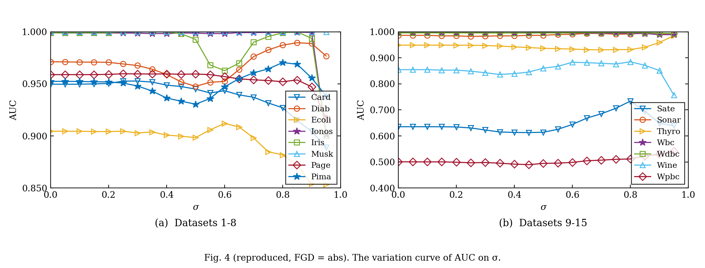
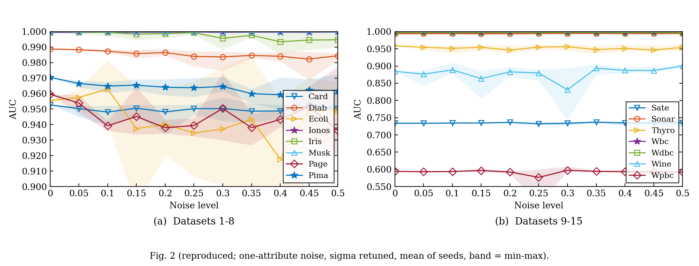
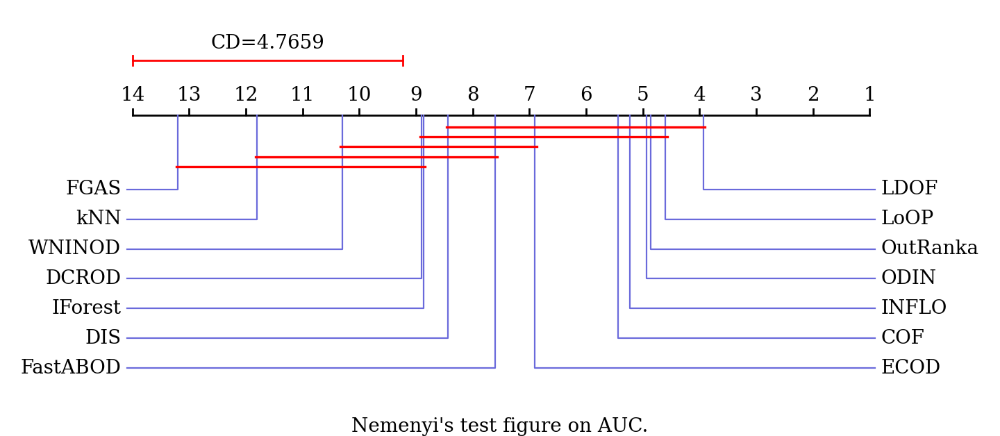
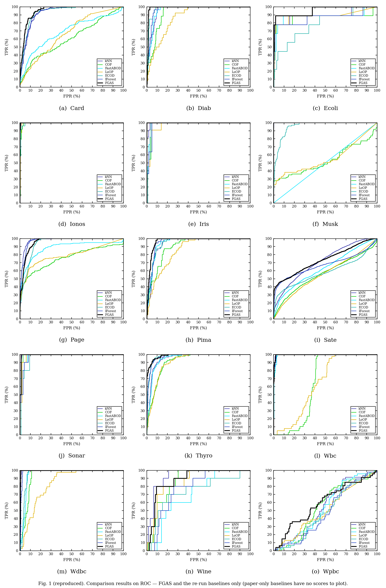

# RESULTS — Reproduction of FGAS (Liu et al., Information Sciences 646 (2023) 119400)

**Bottom line.** The paper's main result reproduces. Using the official code's distance (absolute differences), the FGAS column of **Table 2 matches on all 15 datasets** to within the paper's 3-decimal rounding. The largest difference is 0.0005, and the average is 0.9343 vs the reported 0.934. Fig. 4 is reproduced curve for curve, and Fig. 2 and Fig. 3 are reproduced in substance.

Two things don't hold as printed:
- **Eq. 7 (squared FGD) does *not* produce the published numbers.**
- **The paper's FastABOD column couldn't be reproduced** with a standard implementation.

The rest of this file covers each result alongside the paper's, with deviations and their likely causes. No number below was tuned to fit the paper: every hyperparameter grid is the paper's (or the documented assumption), and every value comes from a logged run.

---

## 0. Setup and provenance

| Item | Value |
|---|---|
| Code | this repo; commits `8d28a90` (M0) … `3865a07` (M7) |
| Data | `BELLoney/FGAS@b450898` `Datasets/*.mat`, SHA-256 in `data/checksums.json`; all 15 match Table 1 (n, m, #outliers) |
| FGAS backend | CuPy 14.2.0 (CUDA 13), float64, RTX 4060 Laptop GPU. Matches CPU float64 exactly in AUC; float32 rejected, ΔAUC up to 0.006 (`results/M3_smoke_and_benchmark.md`). |
| Baselines | pyod 3.6.7, PyNomaly 0.4.0, CPU, 8 processes |
| Python stack | Python 3.14.0, numpy 2.4.2, scipy 1.17.0, scikit-learn 1.8.0 (full `pip freeze` in every `runs/*/meta.json`) |
| Tests | 28 passing (`python -m pytest -q`). They cover parity with the official README example (≤ 1e-4), efficient = literal equations (1e-10), GPU = CPU, AUC = Eq. 13, the paper's 1.5610 / 4.7659, and noise injection. |

Runs behind the numbers below. `runs/` is git-ignored; each run folder holds `config.yaml` and `meta.json`.

| Result | Run | Wall time |
|---|---|---|
| Table 2 FGAS, Fig. 4 | `20261106-145311_table2` | 98 s |
| Baselines, Fig. 1 | `20261106-150449_baselines` | 32 min |
| Fig. 2 | `20261106-163253_noise` | 20 min |

`meta.json` records `git_dirty: true` for these runs. They were launched with config/notes edits that were committed right afterwards: the M4 config was committed in `549a8d5`, and the M7 noise mode in `3865a07`. The exact config used is snapshotted in each run's `config.yaml`.

### Decisions taken during the reproduction (all recorded in NOTES.md §5)

| # | Question | Decision | Evidence |
|---|---|---|---|
| A#1 | FGD: paper Eq. 7 (squared) vs official code (absolute) | **abs = headline**, squared reported as a variant (user decision after M3) | abs reproduces Table 2 15/15 and Fig. 4 point for point; squared doesn't (§1) |
| A#4 | σ grid end point | **0 … 1.0 in steps of 0.05** (paper text). My earlier assumption of 0 … 0.95 was wrong. | Ecoli and Wpbc peak at σ = 1.0 (0.9555, 0.5941); Fig. 4 just doesn't plot σ = 1 |
| A#6 | Fig. 2 vs Table 2 (Thyroid 0.959 vs 0.985) | Fig. 2 used a **step-0.1 σ grid** | best over {0, 0.1, …, 1} equals Fig. 2's noise-0 value on all 15 datasets |
| A#7 | Noise protocol | **one random attribute** per draw (user decision after pre-check) | all-attribute noise collapses AUC by 0.2–0.4, unlike Fig. 2 (§4) |
| A#2/A#3 | tolerance 1e-3 (paper) vs 1e-4 (code); scalar d | 1e-3, scalar d | 1e-4 gives identical AUCs on the checked datasets; scalar d ≡ uniform restart after Eq. 10 (unit test) |

---

## 1. Table 2 — FGAS column (main result)

Best AUC over σ ∈ {0, 0.05, …, 1.0}, d = 0.1, tol = 1e-3. Status: |Δ| ≤ 0.005 match, ≤ 0.02 close, otherwise GAP. Paper values are rounded to 3 decimals, so ±0.0005 is rounding.

| Dataset | Paper | **Ours, abs FGD (code)** | best σ | Δ | % dev | status | Ours, squared FGD (Eq. 7) | Δ | status |
|---|---|---|---|---|---|---|---|---|---|
| Card | 0.953 | **0.9527** | 0.30 | −0.0003 | −0.03% | match | 0.9501 | −0.0029 | match |
| Diab | 0.989 | **0.9895** | 0.85 | +0.0005 | +0.05% | match | 0.9861 | −0.0029 | match |
| Ecoli | 0.955 | **0.9555** | 1.00 | +0.0005 | +0.05% | match | 0.9575 | +0.0025 | match |
| Ionos | 1.000 | **0.9996** | 0.85 | −0.0004 | −0.04% | match | 1.0000 | +0.0000 | match |
| Iris | 1.000 | **1.0000** | 0.25 | 0.0000 | 0.00% | match | 0.9982 | −0.0018 | match |
| Musk | 1.000 | **1.0000** | 0.40 | 0.0000 | 0.00% | match | 1.0000 | 0.0000 | match |
| Page | 0.960 | **0.9597** | 0.25 | −0.0003 | −0.03% | match | 0.9586 | −0.0014 | match |
| Pima | 0.971 | **0.9705** | 0.80 | −0.0005 | −0.05% | match | 0.9638 | −0.0072 | close |
| Sate | 0.734 | **0.7339** | 0.80 | −0.0001 | −0.01% | match | 0.7852 | **+0.0512** | GAP |
| Sonar | 0.995 | **0.9948** | 0.85 | −0.0002 | −0.02% | match | 0.9928 | −0.0022 | match |
| Thyro | 0.985 | **0.9851** | 0.95 | +0.0001 | +0.01% | match | 0.9822 | −0.0028 | match |
| Wbc | 0.997 | **0.9971** | 0.00 | +0.0001 | +0.01% | match | 0.9963 | −0.0007 | match |
| Wdbc | 0.998 | **0.9977** | 0.75 | −0.0003 | −0.03% | match | 0.9970 | −0.0010 | match |
| Wine | 0.885 | **0.8849** | 0.80 | −0.0001 | −0.01% | match | 0.8992 | +0.0142 | close |
| Wpbc | 0.594 | **0.5941** | 1.00 | +0.0001 | +0.01% | match | 0.5704 | **−0.0236** | GAP |
| **Average** | **0.934** | **0.9343** | | −0.0001 | −0.01% | match | 0.9358 | +0.0014 | match |

- **abs: 15/15 match.** squared: 11 match, 2 close, 2 GAP.
- **Likely cause of the squared-variant gaps:** the paper's numbers were produced by the released code, which sums |ΔT| over attributes. Eq. 7 as printed squares the difference. They are different transition matrices and give different rankings: squared is better on Sate (+0.051) and Wine, worse on Wpbc and Pima. *Eq. 7 should be read as a documentation error in the paper.* The squared form is also not a metric, despite the paper calling FGD "a qualified distance measure".
- **"1st order" row** with our FGAS column and the paper's baselines: identical to the paper (FGAS 12, kNN 4, DIS 2, WNINOD 2, COF/DCROD/IForest 1). See `results/table2_fgas.md`.

Files: `results/table2_fgas.{md,csv}`, `results/table2_full_ours.csv`.

## 2. Fig. 4 — AUC vs σ

The figure uses the same layout as the paper (σ from 0 to 0.95, two panels, MATLAB-style markers). Every feature of the paper's curves that I checked against the 300-dpi render is reproduced:
- Iris dips to 0.963 at σ = 0.6.
- Diab dips to 0.948 at σ = 0.5 and peaks at 0.989 at σ = 0.85.
- Pima dips to 0.930 at σ = 0.5 and peaks at 0.971 at σ = 0.8.
- Ecoli peaks at 0.912 at σ = 0.6.
- Sate peaks at 0.734 at σ = 0.8.
- Wine peaks at 0.885 at σ = 0.8.
- Thyro rises to 0.985 at σ = 0.95.
- The curves collapse at σ = 0.95 (Iris, Pima, Page, Ecoli, Wine).

Deviation: none observed beyond reading precision (~±0.003).

**Paper inconsistency explained:** Fig. 4 looked inconsistent with Table 2 for Ecoli (max 0.912 vs 0.955) and Wpbc. Both reach their Table 2 value only at σ = 1.0, which Fig. 4 doesn't plot. Wpbc's σ = 0.85–0.95 points are also hidden behind the legend box, in the paper and in ours.

Squared variant for comparison: `results/fig4_sigma_squared.png`.

## 3. Table 2 — baselines (re-run where a standard library exists)

Best AUC over k = 1 … 60 (kNN, COF, FastABOD, LoOP). ECOD has no parameter. IForest uses 100 trees, mean of 5 seeds. Tolerance for re-run baselines: ≤ 0.01 match, ≤ 0.03 close.

| Method | Library | Paper avg | Ours avg | Δ | match / close / GAP (of 15) |
|---|---|---|---|---|---|
| ECOD | pyod | 0.880 | 0.880 | 0.000 | **15 / 0 / 0** (exact on every dataset) |
| LoOP | PyNomaly | 0.792 | 0.792 | 0.000 | **15 / 0 / 0** |
| IForest | pyod | 0.911 | 0.906 | −0.005 | 12 / 3 / 0 |
| kNN (k-th NN distance) | pyod | 0.911 | 0.922 | +0.010 | 11 / 2 / 2 |
| COF | pyod | 0.808 | 0.801 | −0.007 | 7 / 5 / 3 |
| FastABOD | pyod `ABOD(method='fast')` | 0.538 | 0.839 | **+0.300** | 1 / 1 / **13** |
| DIS, INFLO, LDOF, ODIN, DCROD, OutRanka, WNINOD | — | as reported | **not re-run** | | no standard implementation (A#14) |

Per-dataset values: `results/baselines_vs_paper.md`.

**Likely causes of the gaps:**
- **kNN** (Card 0.929 vs 0.884, Wine 0.929 vs 0.895, Musk 1.000 vs 0.975): ours is *higher*. Plausible causes are a different kNN variant in the authors' MATLAB code (e.g. mean distance, or self counted as a neighbour) or different tie handling with duplicate rows.
- **COF** (Ecoli 0.866 vs 0.902, Wdbc 0.937 vs 0.984, Wine 0.858 vs 0.798): likely implementation differences in the chaining-distance definition and duplicate-point handling. pyod's COF can't run with k = 1 (15 failed fits, excluded).
- **IForest:** random-forest variance. Our standard deviation over 5 seeds reaches 0.022–0.023 (Sate, Wine), and the paper reports a single unseeded run.
- **FastABOD:** the paper's values are 0.38–0.68 (near chance) on 14 datasets, but 0.954 on Musk. 74 of our fits returned NaN scores and were excluded from the best-k search: k ≤ 2 on every dataset, and up to k = 28 / 11 / 6 on the duplicate-heavy Wbc / Thyro / Page. Ours is the opposite: high everywhere except Musk, where pyod ranks inversely (AUC 0.05–0.08 for every k ≥ 4, and exactly 0.5 at k = 3). A sign-flip hypothesis (paper = 1 − our worst k) fits 7/15 datasets within 0.04, including Musk at 0.951, but fails on Iris, Page, Thyro and Wbc. So **the cause is unresolved.** The most likely explanation is an implementation or sign error in the authors' FastABOD baseline, but I can't confirm it (`results/fastabod_sign_check.csv`).

## 4. Fig. 2 — attribute-noise robustness

Protocol (NOTES A#7, decided after a pre-check):
- One randomly chosen attribute per draw; ⌈x·n⌉ random samples get U[min, max] on it.
- x ∈ {0, 0.05, …, 0.5}, 5 seeds.
- σ re-tuned over {0, 0.1, …, 1.0} at each level.
- The plot shows the mean over seeds, with the band = min–max.

| | Value |
|---|---|
| Mean absolute error vs the paper's curves (read off the figure, ±0.003) | **0.0037** |
| Datasets with MAE ≤ 0.01 | **13 / 15** (Ecoli 0.014, Wine 0.013) |
| Paper points inside our seed min–max band (±0.003) | **160 / 165** |
| σ fixed at clean best instead of re-tuned | same picture (MAE 0.0037). `results/fig2_noise_fixed.png` |

Paper's claim: "the AUC curve tends to fluctuate up and down in a small range", i.e. FGAS is robust. **Reproduced** under this protocol:
- Largest mean drop: Wine 0.054, Ecoli 0.038, Page 0.023.
- Most datasets move by ≤ 0.01.

**Deviations and causes:**
- Ecoli and Wine have only 9 and 10 outliers, so a single noisy draw moves AUC by up to 0.17 between seeds. The paper's single curve is one draw, and ours is a 5-seed mean, so exact point-by-point agreement isn't expected.
- Thyroid: the paper's curve is flat at 0.959; ours averages 0.946–0.956.

**Protocol sensitivity (important caveat):** with noise on *every* attribute, which was my original assumption, AUC collapses (e.g. Pima 0.971 → 0.622, Page 0.960 → 0.655 at x = 0.5). The robustness claim therefore depends on the noise affecting a single attribute, a detail the paper only hints at ("a specific attribute").

Files: `results/fig2_vs_paper.{md,csv}`, plus single-seed versions `results/fig2_noise_*_seed0.png`.

## 5. Fig. 3 / Section 4.4 — Friedman and Nemenyi tests (α = 0.1)

| Table used | τ_F | F_crit (13, 182) | CD | FGAS avg rank | FGAS **not** significantly different from |
|---|---|---|---|---|---|
| Paper (reported) | 15.1347 | 1.5610 | 4.7659 | — | kNN, WNINOD, IForest, DCROD |
| Paper's Table 2, recomputed | 15.0714 (−0.4%) | **1.5610** | **4.7659** | 1.633 | kNN, WNINOD, IForest, DCROD, **DIS** |
| Our FGAS + paper baselines | 15.0449 | 1.5610 | 4.7659 | 1.633 | same as above |
| Our FGAS + our re-run baselines + paper for the rest | 12.6418 | 1.5610 | 4.7659 | 1.800 | **kNN, WNINOD, IForest, DCROD** |

- The critical value and CD reproduce exactly (q₀.₁₀(14) = 3.12). The small τ_F gap is consistent with computing from 3-decimal AUCs.
- **Inconsistency in the paper:** from its own Table 2, the FGAS–DIS rank gap is 4.667 < CD = 4.7659. So FGAS and DIS are *not* significantly different, contrary to the paper's text, by a margin of 0.1 rank. With our re-run baselines the paper's stated grouping comes out exactly, but that's coincidental: it's driven by our higher FastABOD and kNN changing the ranks.
- The overall conclusion (significant differences exist, and FGAS is in the top group with kNN, WNINOD, IForest and DCROD) holds.

Diagrams: `results/fig3_cd_{paper,ours_fgas,ours_rerun}.png`. Statistics: `results/fig3_stats.md`.

## 6. Fig. 1 — ROC curves

Same 5×3 layout and axes (FPR % vs TPR %), FGAS in black.
- Drawn for **FGAS and the 6 re-run baselines only**. The 7 paper-only baselines have no scores, so they can't be plotted.
- FGAS curves agree with the paper's qualitative description: they hug the top-left corner on Iris and Musk, lead on Card, Pima and Wpbc, and run close to other methods on Page, Wdbc and Wine.
- Ecoli's FGAS curve has the same shape as the paper's (89% TPR at about 0% FPR, 100% at about 38% FPR).
- Not reproducible: the curves of the 7 unimplemented baselines, and the paper's per-panel x-axis limits (MATLAB auto-ranging). Ours use 0–100 throughout.

---

## 7. What could not be reproduced, and why

| Item | Status | Reason / closest feasible experiment |
|---|---|---|
| Eq. 7 exactly as printed | Doesn't produce the paper's numbers | Released code uses |Δ|, not (Δ)². Both variants are reported. |
| DIS, INFLO, LDOF, ODIN, DCROD, OutRanka, WNINOD | Not re-run | No standard Python implementations; DIS's score isn't even defined in the paper. Paper values used, clearly labelled. Re-implementing them from their source papers would be a separate project. |
| FastABOD column | Not reproduced (13/15 gaps) | pyod's FastABOD gives sensible AUCs (avg 0.839); the paper's are near chance. Cause unresolved (§3). |
| Fig. 2 point-for-point | Reproduced within seed variance only | Paper shows one unseeded random draw; noise protocol had to be inferred (A#7). |
| Hardware/runtime comparison | Not possible | Paper reports none. Ours: FGAS on all 15 datasets × 21 σ takes 46.6 s (abs) and 45.7 s (squared) on the GPU. Satellite alone: 16 s for 21 σ on GPU, vs 320 s for 20 σ on CPU (M3 benchmark). |
| Fig. 3 "FGAS ≠ DIS" | Contradicted by the paper's own numbers | Rank gap 4.667 < CD 4.7659 (§5). |

## 8. Things worth knowing about FGAS itself (observed, not claimed by the paper)

- **Tuning uses the labels:** the paper selects σ (and every baseline's k) using the ground-truth labels. Every Table 2 number is therefore an optimistic upper bound for unsupervised use. Using one σ for all datasets gives a lower average than the per-dataset oracle's 0.934:
  - the best single σ (0.8) averages **0.9175**
  - σ = 0 averages 0.9103
  - σ = 0.5 averages 0.9038
  - σ = 1.0 averages 0.6210

  These are computed from `runs/20261106-145311_table2/auc.csv` (abs FGD, mean AUC over the 15 datasets at each σ). Even σ = 0.8 is chosen with hindsight.
- **σ = 1.0** turns the granule into an exact-value frequency count. Two of the 15 Table 2 numbers (Ecoli, Wpbc) come from that degenerate setting.
