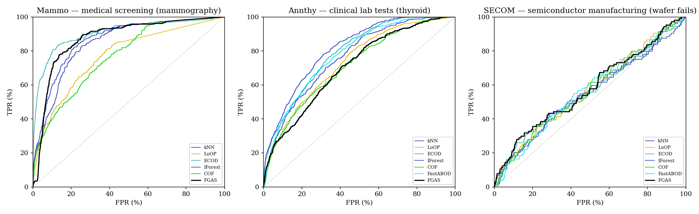
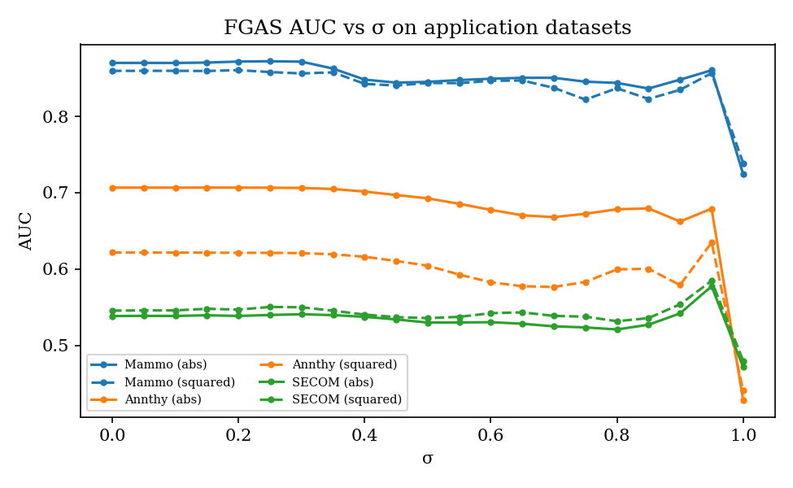

# FGAS on real-world application datasets (extension, not in the paper)

**Protocol:** the same as the paper's Table 2 (best AUC over the paper's grids, so oracle tuning using labels).
- FGAS: σ ∈ {0, 0.05, …, 1}, d = 0.1, GPU float64.
- kNN / COF / FastABOD / LoOP: k = 1…60.
- IForest: mean ± std over 5 seeds.
- Preprocessing: per-attribute min-max scaling; SECOM's 4.5% missing values filled with the column mode (the paper's method).
- "σ = 0.8 fixed" is a label-free setting: the best single σ across the paper's 15 datasets.

**Data:**

| Dataset | Application | n × m | Anomalies | Source |
|---|---|---|---|---|
| Mammo | mammography screening | 11,183 × 6 | 260 | ADBench `23_mammography.npz` @3dac822 |
| Annthy | thyroid lab tests | 7,200 × 6 | 534 | ADBench `2_annthyroid.npz` @3dac822 |
| SECOM | semiconductor wafer fails | 1,567 × 590 | 104 | UCI SECOM |

Checksums are in `data/checksums_ext.json`.

**Runs:**
- `20261106-174713_ext_fgas`: 18 s / 8 s / 9 s per FGD variant on the GPU; peak GPU memory 2.3 GB on Mammo.
- `20261106-174839_ext_baselines`: kNN, LoOP, ECOD, IForest; 80 s.
- `20261106-175246_ext_baselines`: COF, FastABOD; 36.6 min on 6 CPU processes.

## Results (AUC; rank among all 10 rows per dataset)

See `EXTENSIONS_table.md` (generated by `scripts/make_ext_report.py`). Ranking FGAS (abs, best σ) against the 6 baselines only (7 methods):

| Dataset | FGAS (abs) | Best baseline | FGAS rank of 7 |
|---|---|---|---|
| Mammo | 0.872 | ECOD 0.906 | **2** |
| Annthy | 0.707 | IForest 0.827 ± 0.015 | **7** (COF 0.712 just above) |
| SECOM | 0.578 | LoOP 0.569 | **1**, but every method is ≤ 0.585 (near chance) |

## Takeaways

1. **FGAS doesn't carry its paper-level performance over to these datasets.** It averages 0.934 on the paper's 15 datasets, but 0.872 / 0.707 / 0.578 here. It's competitive on mammography (2nd) and last on annthyroid.
2. **Annthyroid shows FGAS's main limitation.** Thyroid disease shows up as *combinations* of hormone levels, and FGAS scores each attribute's typicality separately. IForest and ECOD, which use the full distributions, do much better (0.83 / 0.79).
3. **Mammography:** the 6 heavy-tailed features squash min-max-scaled values near 0, and the best σ is low (0.25). FGAS's top-ranked ~3% of samples are almost all normal (flat start of the ROC curve). It catches up later, but ECOD is far better at low false-positive rates, which matters most for screening.
4. **SECOM is hard for every unsupervised method** (all 0.55–0.59). Wafer fails aren't outliers in the 590-dimensional sensor space. FGAS is nominally first, but the differences are within noise (IForest's seed std is 0.016).
5. **Without labels, FGAS drops further:** σ = 0.8 fixed gives 0.844 / 0.678 / 0.521, and the paper's squared Eq. 7 is worse than abs on Mammo and Annthy.
6. **FastABOD (pyod) fails on Mammo:** NaN scores for every k, caused by 3,335 duplicate rows. COF fails at k = 1 everywhere (a library limit).
